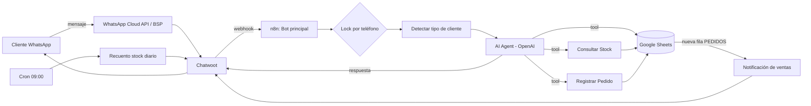
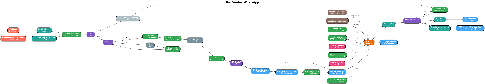
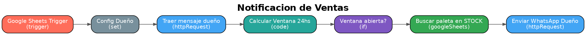
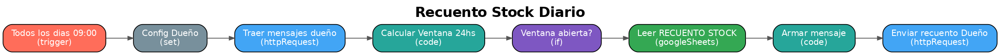

# 🏓 Bot de ventas por WhatsApp con IA (n8n + OpenAI + Google Sheets + Chatwoot)

Asistente conversacional de ventas para una tienda de paletas de pádel. Atiende consultas de clientes por WhatsApp, responde stock y precios en tiempo real desde una planilla de Google Sheets, registra pedidos, permite el seguimiento de envíos, abre reclamos y le avisa al dueño de cada venta. Todo orquestado en **n8n**, con un agente de **OpenAI** y **Chatwoot** como CRM.

> ⚠️ Proyecto real en producción, publicado de forma **anonimizada**: se eliminaron credenciales, URLs, teléfonos, IDs, datos de pago y nombres de marca/personas (reemplazados por marcadores como `<CHATWOOT_HOST>` o `[TIENDA]`).

## ✨ Qué hace

- **Atención 24/7 por WhatsApp** en español rioplatense, con memoria de conversación.
- **Consulta de stock y precios en vivo** desde Google Sheets (solo paletas `DISPONIBLE`).
- **Precios diferenciados** mayorista / minorista, detectados automáticamente por el teléfono del cliente (el bot nunca revela el precio del otro tipo).
- **Registro de pedidos** con número de venta correlativo y descuento automático de stock.
- **Seguimiento de pedido** (INICIADO → EMBALADO → DESPACHADO → ENTREGADO).
- **Consulta de mercadería "en camino"** y **apertura de reclamos** (derivados a un humano).
- **Notificación al dueño** por cada venta (modelo, cantidad, precio en USD y ARS, cliente, fecha).
- **Recuento de stock diario** enviado automáticamente a las 09:00.
- **Control anti-concurrencia** (locks por teléfono) para no procesar dos mensajes del mismo cliente a la vez.
- **Registro de todas las conversaciones** en Chatwoot (CRM).

## 🧩 Arquitectura



| Componente | Rol |
|---|---|
| **n8n** (self-hosted) | Orquestación de los 5 workflows |
| **OpenAI (gpt-5-mini)** | Agente con herramientas (tool calling) y memoria de ventana |
| **Google Sheets** | Base de datos: stock, pedidos, mayoristas, locks, reclamos |
| **Chatwoot** | CRM / bandeja de entrada y canal de envío |
| **WhatsApp Cloud API** | Canal de mensajería (ventana de 24 hs) |

## 📂 Contenido del repositorio

```
├── README.md
├── workflows/                      # JSON importables en n8n (sanitizados)
│   ├── 01_bot_principal.json
│   ├── 02_consultar_stock.json
│   ├── 03_registrar_pedido.json
│   ├── 04_notificacion_ventas.json
│   └── 05_recuento_stock_diario.json
├── docs/
│   ├── diagramas/                  # Diagramas de cada flujo (PNG)
│   └── estructura-hojas.md         # Esquema de la base de datos en Sheets
└── .gitignore
```

## 🔄 Los 5 workflows

### 1. Bot principal
Recibe el mensaje (webhook), toma un **lock** por teléfono (espera si hay otro mensaje en proceso), identifica si es **mayorista** consultando la hoja `MAYORISTAS`, crea/recupera el contacto y la conversación en Chatwoot y ejecuta el **AI Agent**. El agente dispone de 6 herramientas: `consultar_stock`, `registrar_pedido`, `descontar_stock`, `consultar_pedido`, `consultar_en_camino` y `abrir_reclamo`. Al terminar responde por el canal correspondiente y **libera el lock**. Incluye un filtro de contactos desactivados y evita bucles de eco entre inboxes.



### 2. Consultar Stock (sub-workflow)
Lee la hoja `STOCK`, filtra `ESTADO = DISPONIBLE` y devuelve un único precio según el tipo de cliente, junto con la cotización del dólar.


### 3. Registrar Pedido (sub-workflow)
Cuenta los pedidos existentes, genera el siguiente número de venta correlativo y agrega la fila en `PEDIDOS`.


### 4. Notificación de Ventas
Trigger sobre nuevas filas de `PEDIDOS` (revisa cada minuto). Verifica que la **ventana de 24 hs de WhatsApp** esté abierta, busca la paleta en `STOCK`, calcula el precio en USD y ARS y envía al dueño un mensaje por cada venta (soporta varias ventas simultáneas).



### 5. Recuento de Stock Diario
Todos los días a las 09:00 lee la hoja `RECUENTO STOCK` (se arma sola con fórmulas `QUERY`), compone el mensaje (dividiéndolo si supera el límite de caracteres) y lo envía al dueño.



## 🗃️ Base de datos (Google Sheets)

Ver [`docs/estructura-hojas.md`](docs/estructura-hojas.md). Hojas: `STOCK`, `PEDIDOS`, `MAYORISTAS`, `EN CAMINO`, `RECLAMOS`, `LOCKS`, `CHATWOOT`, `CONTACTOS DESACTIVADOS`, `RECUENTO STOCK` y `CONTROL PRECIOS`.

## 🛠️ Decisiones técnicas destacadas

- **Prompt con reglas de negocio** (más de 35): anti-alucinación de precios, anti-duplicado de pedidos, confidencialidad de precios y de metadatos de la planilla.
- **Precio siempre fresco**: el agente debe volver a consultar stock en cada turno relevante.
- **Mutex en Sheets** (`LOCKS`) para serializar mensajes por cliente.
- **Manejo multi-ítem** en n8n (`$input.all()` / `$itemIndex`) para notificar varias ventas en una sola ejecución.
- **Planilla informativa** (`CONTROL PRECIOS`) con alerta si dos paletas iguales tienen precios distintos.
- **Costos de WhatsApp**: manejo de la ventana de 24 hs y del error 131042 (método de pago en Meta).

## 🚀 Cómo replicarlo

1. Instalar n8n e importar los 5 JSON (`Workflows → Import from file`).
2. Crear las credenciales: Google Sheets (OAuth2), OpenAI y los tokens de Chatwoot.
3. Crear la planilla con las hojas descritas en `docs/estructura-hojas.md` y reemplazar `<SPREADSHEET_ID>`.
4. Reemplazar los marcadores: `<CHATWOOT_HOST>`, `<CHATWOOT_API_TOKEN>`, `<INBOX_IDENTIFIER>`, `<WEBHOOK_PATH>`, `<PHONE_NUMBER>`, `[TIENDA]`, etc.
5. Reapuntar los nodos *Execute Workflow* (`<WORKFLOW_ID_...>`) a los sub-workflows importados.
6. Configurar el webhook de Chatwoot hacia el webhook de n8n y activar los workflows.

## 🧰 Stack

`n8n` · `OpenAI API` · `Google Sheets API` · `Chatwoot` · `WhatsApp Cloud API` · `JavaScript` · `Webhooks` · `OAuth2`
